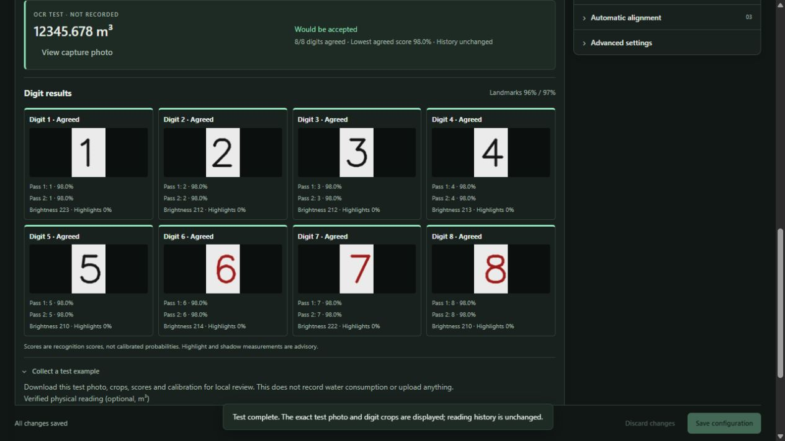

# WaterWatch ESPHome OCR

Read a mechanical water meter with an **AI Thinker ESP32-CAM running ESPHome** and
run OpenCV/Tesseract recognition locally on the **Home Assistant host**.

[](https://my.home-assistant.io/redirect/supervisor_add_addon_repository/?repository_url=https%3A%2F%2Fgithub.com%2Fmartincortina%2Fesphome-waterwatch)



*Interface preview uses synthetic meter data and a test recognizer; it is not a
measurement of real-meter OCR accuracy.*

## Install

1. In Home Assistant, open **Settings → Apps/Add-ons → Store → ⋮ → Repositories**.
2. Add `https://github.com/martincortina/esphome-waterwatch`.
3. Install **WaterWatch ESPHome OCR**, keep `publish_to_mqtt: false`, then start it
   and select **Open Web UI**. The first installation builds its container locally.
4. Register a meter, select its HA camera entity and save. Optionally select its
   ESPHome illumination light and enable **Flash the meter light for each picture**.
5. Preview, set digit regions and decimal places, and test OCR. Verify the physical
   meter before recording a baseline or enabling scheduled readings/publication.

Supported HA hosts: **aarch64** and **amd64**. The ESPHome camera is set up separately
using [the generic template](esphome/waterwatch-ai-thinker.yaml). The example secrets
are public validation fixtures: replace them before flashing a real device.
No SD card is required. See [setup and calibration](waterwatch_esphome/DOCS.md).

## Features and limits

- Native ESPHome camera transport through HA; images remain on your own host.
- Optional brief LED illumination for each preview or OCR reading; LED off between
  captures, with device-side timeout and host cleanup. No continuous light required.
- Compact ingress workshop with dark/light/system themes, digit regions, zoom,
  static perspective correction, dry-run OCR and a dedicated history view.
- Quarter turns and fine-angle straightening, saved per meter and applied before
  OCR crops the digits. Original camera images stay unchanged.
- Edit existing digit boxes by selecting and dragging them or their resize handles.
  Undo/redo, individual deletion and keyboard adjustments help refine calibration.
- Rotate individual digit boxes with an angle field or round handle. OCR rectifies
  each oriented crop independently of the photograph's overall rotation.
- Two fixed landmarks optionally align each capture to a saved reference before OCR.
  Uncertain matches stop processing; large camera movement requires recalibration.
- Exact test images, per-digit results/quality measurements, group edits, precise
  coordinates and local diagnostic-bundle exports support calibration and validation.
- SQLite history, explicit baseline/corrections, image quality and plausibility checks.
- Optional MQTT discovery and cumulative water statistics, disabled by default.

**Experimental:** this uses host-side Tesseract, not AI-on-the-edge-device's neural
model. It has no trained analog-pointer or wheel-transition recognizer. Landmark
alignment and confidence scores do not establish real meter accuracy.
Test and calibrate your actual meter before enabling publication.

HA access is GET-only by default. Selecting a flash light permits only that entity's
timed `light.turn_on` and cleanup `light.turn_off`. No host network, host config mounts
or privileged device access are requested. Supervisor credentials remain in memory.

## Development

```sh
python -m pip install -r requirements-dev.lock
python -m pytest -q
node --test tests/roi_geometry.test.cjs tests/test_bundle.test.cjs
python -m ruff check waterwatch_esphome/server tests
docker build -t waterwatch-esphome:dev ./waterwatch_esphome
```

Tests use synthetic fixtures; native Tesseract and a live MQTT broker are separate
checks. Run the commands above to validate changes locally.

Application code is MIT licensed. No upstream recognition models or meter photos
are bundled. See [third-party notices](THIRD_PARTY_NOTICES.md).
